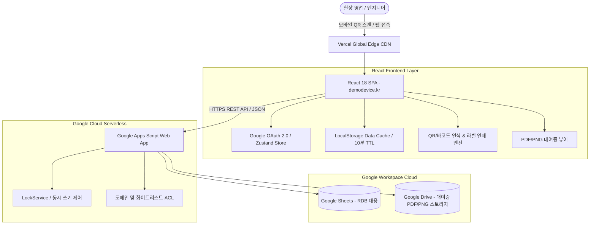

# Demo Inventory App (`demodevice.kr`)
> **사내 데모 장비 관리 및 대여증 자동 발급 서버리스 클라우드 웹 애플리케이션**  
> 1인 풀스택 기획·설계·구현·실서비스 운영 (2025.03 ~ 현재)

[](https://demodevice.kr)
[](https://react.dev)
[](https://vercel.com)
[-34A853.svg)](https://developers.google.com/apps-script)
[](https://www.google.com/sheets)
[](LICENSE)

---

## 📌 Executive Summary

화상회의 및 하드웨어 솔루션 영업 현장에서는 수백 대의 고가 데모 장비가 11개 영업·기술지원 팀, 수십 개 파트너사로 빈번하게 출고·회수됩니다.  
본 프로젝트는 **기존 수기 장부나 로컬 엑셀 관리의 분실 위험, 중복 대여 충돌, 대여증 수기 작성의 비효율**을 해결하기 위해 개발된 사내 클라우드 관리 시스템입니다.

- **운영 기간:** 2025년 3월 24일 ~ 현재 (19개월 이상 무중단 운영)
- **실서비스 트래픽:** 총 대여 **552건**, 반납 **473건** 처리 (누적 1,025건 트랜잭션)
- **관리 자산:** 137대 고가 데모 장비 실시간 상태 및 시리얼 단위 위치 추적
- **비용 최적화:** **$0 (Zero Dollar Architecture)** — 전 인프라 프리티어 및 서버리스 연동

---

## 🏗 System Architecture & Decisions



### 💡 왜 무거운 RDB 대신 `Google Sheets + GAS + Vercel`을 선택했는가?

| 비교 항목 | 전통적 RDB + EC2/컨테이너 스택 | 본 프로젝트 아키텍처 (React + GAS + Sheets) | 의사결정 배경 |
| :--- | :--- | :--- | :--- |
| **운영 비용** | 월 최소 $40~$100+ (DB 인스턴스, 서버 유지비) | **$0 / 월** (Vercel 무료 티어 + Google Workspace 활용) | 사내 PoC 및 실운영 단계에서 추가 인프라 예산 없이 영구 무료 운영 달성 |
| **백오피스 관리** | 별도의 관리자 어드민 페이지(CRUD UI) 구축 필수 | **Google Sheets UI 자체를 어드민 콘솔로 즉시 활용** | 비개발 직군(영업지원, 물류담당자)이 웹앱 없이도 엑셀 인터페이스에서 직접 대량 편집 가능 |
| **협업 권한** | 사내 IAM 및 복잡한 DB 접근 권한 분리 필요 | **구글 워크스페이스 사내 계정 연동 (ACL 자동 상속)** | 사내 도메인 로그인만으로 완벽한 인가 제어 |
| **문서 자동화** | PDF 렌더링 서버(Headless Chrome 등) 별도 운영 | **스프레드시트 템플릿 복제 -> PDF 변환 API 내장** | 대여증 양식을 엑셀 템플릿으로 디자이너가 편집하고 코드는 셀 바인딩만 수행 |

---

## 🚀 Key Features & Implementation Details

### 1. 모바일 QR 현장 진입 & 비로그인 리다이렉트 보존
- 장비에 부착된 개별 QR 코드를 모바일 카메라로 스캔하면 해당 장비 상세 페이지(`demodevice.kr/?serial=...`)로 즉시 연결.
- 미로그인 상태일 경우 구글 OAuth 로그인 후 원래 스캔했던 장비 신청 화면으로 유실 없이 복원 (`App.js`, `OAuthCallback.js`).

### 2. 원클릭 대여증 자동 생성 및 Google Drive 연동
- 신청 장비, 대여 기간, 파트너사 정보 입력 시 GAS가 Google Spreadsheet 대여증 템플릿을 복제하여 셀 매핑.
- Google Drive API를 통해 고해상도 PDF 및 모바일 확인용 PNG/JPG 썸네일을 동시 렌더링 후 드라이브에 아카이빙 (`JpgViewer.js`, `googleSheetPdfExporter.js`).

### 3. A4 라벨지 인쇄 엔진 (현장 요청 UX 개선 사례)
- **현장 문제:** 16칸짜리 A4 라벨지(폼텍 등)를 사용할 때 몇 장만 출력하면 남은 칸을 버리게 되어 용지 낭비 심각.
- **해결책 (`LabelPrintPage.js`):** 사용자가 라벨지의 **'출력 시작 칸(Index 0~15)'**을 직접 지정할 수 있는 오프셋 건너뛰기 기능 구현. 이미 사용한 칸을 피해 새 라벨을 인쇄하여 소모품 낭비 방지.

### 4. 동시성 락 및 캐싱 최적화
- GAS의 짧은 실행 제한 시간(6분)과 시트 쓰기 충돌을 방지하기 위해 `LockService.getScriptLock()`을 통한 직렬화 트랜잭션 보장.
- 프론트엔드에서는 10분 TTL의 `LocalStorage` 캐싱(`dataCache.js`)을 적용하여 재고 목록 재조회 시 불필요한 API 왕복 지연 80% 이상 단축.

---

## 📊 Real-world Operational Evidence (실제 운영 증거)

본 시스템은 단순 토이 프로젝트가 아닌 실제 사내 비즈니스 프로세스에 깊숙이 통합되어 운영되었습니다.

- **집계 기간:** 2025-03-24 ~ 2026-10-22 (총 577일간의 운영 데이터)
- **활용 부서 (11개 부서):** 기술지원팀, 솔루션영업팀, 엔터프라이즈영업팀, 파트너사업팀, 전략기획실 등
- **누적 트랜잭션:**
  - 장비 대여 신청: **552건**
  - 장비 반납 처리: **473건**
  - 웹앱 자동 타임스탬프 기록: **85건**
- **관리 품목:** Logitech Rally Bar, Tap IP, MeetUp, Scribe, RoomMate, Logi Dock 등 137대 데모 장비

---

## 📁 Repository Structure

```
demo-inventory/
├── frontend/                     # React 18 SPA (Vercel 배포)
│   ├── public/                   # 정적 에셋 및 가명화된 샘플 CSV
│   │   ├── 장비현황.csv           # 장비 마스터 데이터 스키마
│   │   ├── 사용내역.csv           # 대여/반납 이력 스키마
│   │   └── 파트너정보.csv         # 파트너사 정보 스키마
│   ├── src/
│   │   ├── components/           # 재사용 UI 컴포넌트
│   │   │   ├── BarcodeSvg.js     # Code128 바코드 렌더링
│   │   │   ├── GoogleOAuthButton.js
│   │   │   ├── JpgViewer.js      # 대여증 이미지 뷰어 모달
│   │   │   └── MultiEquipmentApplicationForm.js # 다중 장비 원클릭 대여 신청폼
│   │   ├── pages/                # 라우트 페이지
│   │   │   ├── MainPage.js       # 실시간 재고 뷰어 및 메인 대시보드
│   │   │   ├── LabelPrintPage.js # 라벨 오프셋 인쇄 페이지
│   │   │   ├── QrPrintPage.js    # 장비 부착용 QR 생성 페이지
│   │   │   └── InventoryAuditPage.js # 반기/분기 재고 실사 전용 페이지
│   │   ├── services/api.js       # GAS Web App REST 클라이언트
│   │   ├── stores/authStore.js   # Zustand 인증 상태 스토어
│   │   └── utils/                # PDF 변환, 캐시, CSV 파서 유틸리티
│   ├── package.json
│   ├── vercel.json               # SPA 라우팅 리라이트 설정
│   └── .env.example              # 클라이언트 환경변수 템플릿
│
├── backend-gas/                  # Google Apps Script 서버리스 백엔드
│   ├── Code.gs                   # 3,400+ LOC 단일 풀스택 백엔드 스크립트
│   │                             # (REST 라우팅, LockService, PDF 템플릿 엔진, Drive 연동)
│   ├── appsscript.json           # GAS 매니페스트 및 OAuth 스코프
│   └── README.md                 # GAS Script Properties 설정 및 배포 가이드
│
├── docs/                         # 아키텍처 및 상세 가이드 문서
│   ├── ARCHITECTURE.md           # 시스템 아키텍처 다이어그램 및 설계 원칙
│   └── CODEBASE_GUIDE.md         # 주요 모듈별 상세 역할 설명
│
└── README.md                     # 프로젝트 총괄 문서
```

---

## 🛠 Local Setup & Installation

### Frontend (React)
```bash
cd frontend

# 의존성 설치
npm install

# 환경변수 설정
cp .env.example .env.local
# .env.local에 REACT_APP_GOOGLE_CLIENT_ID 및 REACT_APP_GAS_URL 기입

# 로컬 개발 서버 실행
npm start
```

### Backend (Google Apps Script)
1. [Google Apps Script](https://script.google.com)에서 새 프로젝트 생성.
2. `backend-gas/Code.gs`와 `backend-gas/appsscript.json` 내용을 붙여넣기.
3. **프로젝트 설정 > 스크립트 속성(Script Properties)**에 시트 ID 및 구글 클라이언트 키 입력 (상세: [backend-gas/README.md](backend-gas/README.md)).
4. **배포 > 웹 앱으로 배포** (`액세스 권한: 모든 사용자` 설정 후 생성된 URL을 프론트엔드 `.env.local`에 연결).

---

## 🔒 Security & Privacy Notice
- 본 공개 저장소는 사내 보안 규정을 준수하여 **실제 구글 시트 ID, API 키, 거래처 담당자 실명/연락처, 장비 시리얼 번호**를 일체 포함하지 않으며, 전량 Mock/환경변수 인터페이스로 추상화되어 있습니다.
